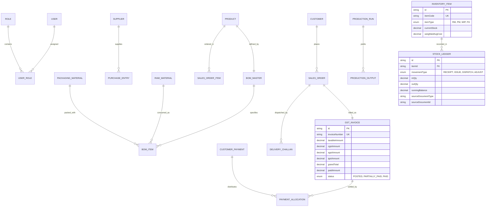

# Order-to-Audit ERP: Technical Design Note

**System Architecture & Engineering Specification**  
**Document Classification**: Engineering Technical Design Note (2-Page Specification)  
**Standard**: Ind AS 2 / IAS 2, GST Statutory Compliance, Double-Entry Inventory Ledger  

---

## 1. Domain Data Model & Entity-Relationship Architecture

The Order-to-Audit ERP core data model partitions enterprise business entities into strict relational domains to ensure transactional atomicity, referential integrity, and immutability:

---

## 2. Bill of Materials (BOM) Mathematical Model

The Bill of Materials defines standard input requirements to produce one standard output batch of finished goods ($Q_{\text{batch}}$). For each raw or packaging ingredient $i$:

$$\text{Gross Standard Requirement } (Q_{\text{std}, i}) = Q_{\text{net}, i} \times \left(1 + \frac{W_i}{100}\right)$$

Where:
- $Q_{\text{net}, i}$ = Theoretical net input quantity for product formulation.
- $W_i$ = Configured normal process wastage / scrap allowance percentage.
- For packaging materials (pouches, cartons), $W_i$ represents standard machine line loss.

**Benchmark Production Formulation (Murukku 200g, 200 Packets Output Batch)**:
- Raw Rice Flour: $40.00\text{ kg}$ gross dough requirement.
- Refined Sunflower Oil: $10.00\text{ L}$ standard absorption.
- Premium Spice Mix: $1.20\text{ kg}$ standard seasoning.
- Printed Pouches: $200\text{ pcs} \times (1 + 0.03\text{ scrap allowance}) = 206\text{ pcs}$.
- Master Cartons: $10\text{ pcs}$ ($20\text{ packets/carton}$).

---

## 3. Stock Ledger Invariants & Double-Entry Balance Formula

The system enforces strict 4-category physical segregation:
1. `RAW_MATERIAL` (RM)
2. `PACKAGING_MATERIAL` (PM)
3. `WORK_IN_PROGRESS` (WIP)
4. `FINISHED_GOODS` (FG)

### Perpetual Inventory Invariant Formula:
$$\text{Closing Stock } (S_t) = S_{t-1} + \text{Receipts } (R_t) - \text{Issues } (I_t) - \text{Dispatches } (D_t) \pm \text{Adjustments } (A_t)$$

### Fundamental System Invariants:
1. **Source Document Mandatory**: Every ledger row must link directly to a verified source document (`PURCHASE_GRN`, `PRODUCTION_RUN`, `DELIVERY_CHALLAN`, `STOCK_ADJUSTMENT`). No orphan movements can exist.
2. **Negative Stock Prohibition**: At point of posting, if $S_t < 0$, transaction aborts immediately with HTTP 400 (`INSUFFICIENT_STOCK`).
3. **Dispatch Decoupling**: Creation or approval of a Sales Order or GST Invoice creates **no** physical inventory deduction. Finished goods inventory decreases **only** upon generation and dispatch of a confirmed `DELIVERY_CHALLAN`.

---

## 4. Production Yield & Variance Calculations

When a production run is posted, actual output and actual consumption are reconciled against planned standards:

$$\text{Commercial Good Yield \%} = \left(\frac{Q_{\text{actual\_good}}}{Q_{\text{planned\_output}}}\right) \times 100$$
$$\text{Production Scrap Loss \%} = \left(\frac{Q_{\text{damaged}} + Q_{\text{scrap}}}{Q_{\text{planned\_output}}}\right) \times 100$$

### Material Consumption Variance:
$$\Delta M_i = \left(\frac{Q_{\text{actual\_consumed}, i} - Q_{\text{planned\_consumed}, i}}{Q_{\text{planned\_consumed}, i}}\right) \times 100$$
- If $|\Delta M_i| > 3.0\%$, the ERP flags an automatic supervisor investigation alert.
- **Benchmark Event**: Refined oil consumed was $10.5\text{ L}$ vs $10.0\text{ L}$ planned $\rightarrow \Delta M_{\text{oil}} = +5.0\%$ (Alert triggered).

---

## 5. Production Costing Absorption (Ind AS 2 / IAS 2)

Manufacturing cost valuation complies with Ind AS 2, absorbing normal production losses and manufacturing overheads directly into finished good commercial inventory:

$$\text{Total Production Batch Cost } (C_{\text{batch}}) = C_{\text{direct\_material}} + C_{\text{overheads}}$$
$$C_{\text{direct\_material}} = \sum_{i=1}^{n} \left(Q_{\text{actual\_consumed}, i} \times \text{WAC}_i\right)$$
$$C_{\text{overheads}} = C_{\text{labour}} + C_{\text{power\_gas}} + C_{\text{other\_allocated}}$$

### Final Commercial Unit Valuation:
$$\text{Cost Per Good Packet} = \frac{C_{\text{batch}}}{Q_{\text{actual\_good}}}$$

### Benchmark Execution:
- Direct Material ($40\text{ kg flour} + 10.5\text{ L oil} + 1.2\text{ kg spice} + 194\text{ pouches} + 9\text{ cartons}$) = $₹4,108.50$.
- Manufacturing Overheads ($₹1,200\text{ labour} + ₹600\text{ power}$) = $₹1,800.00$.
- Total Batch Cost = $₹5,908.50$.
- Commercial Good Output = $188\text{ packets}$.
$$\text{Unit Cost} = \frac{₹5,908.50}{188} = \mathbf{₹31.4282\text{ per packet}}$$

---

## 6. Inventory Valuation: Moving Weighted-Average Cost (WAC)

All raw materials and packaging materials are valued using the Moving Weighted-Average Cost method, updated dynamically upon every confirmed Goods Receipt Note (GRN):

$$\text{New WAC} = \frac{(S_{\text{existing}} \times \text{WAC}_{\text{existing}}) + (Q_{\text{new}} \times P_{\text{purchase}})}{S_{\text{existing}} + Q_{\text{new}}}$$

### Benchmark Proof (Raw Rice Flour Purchase):
- Existing balance: $100.00\text{ kg}$ @ $₹42.00/\text{kg} = ₹4,200.00$.
- New purchase receipt: $60.00\text{ kg}$ @ $₹45.00/\text{kg} = ₹2,700.00$.
$$\text{Updated WAC} = \frac{₹4,200.00 + ₹2,700.00}{100\text{ kg} + 60\text{ kg}} = \frac{₹6,900.00}{160\text{ kg}} = \mathbf{₹43.125/\text{kg}}$$
- Material issued to production ($40\text{ kg}$) is charged at this exact prevailing WAC ($40 \times ₹43.125 = ₹1,725.00$).
