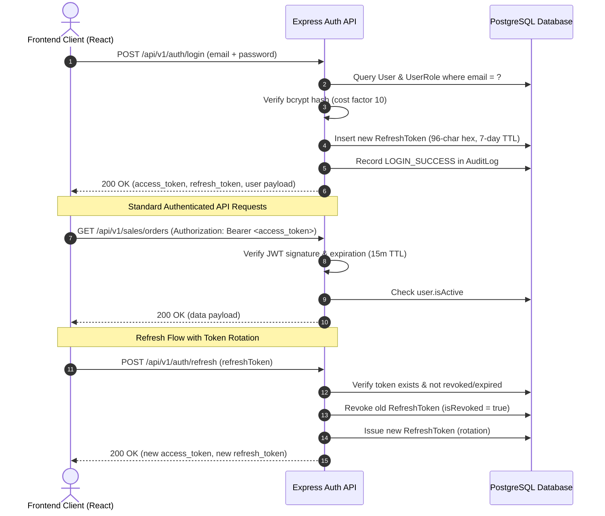

# Order-to-Audit ERP — Authentication & RBAC Architecture

This document specifies the security, authentication, and role-based access control (RBAC) architecture implemented for the Order-to-Audit Manufacturing ERP system.

---

## 1. Security & Token Lifecycle

### Dual-Token Architecture


1. **Access Tokens**:
   - Short-lived JSON Web Token (15-minute expiration).
   - Contains claims: `userId`, `email`, `firstName`, `lastName`, `roles: SystemRole[]`, and calculated `permissions: PermissionCode[]`.
   - Signed cryptographically using HMAC-SHA256 with `JWT_SECRET`.
2. **Refresh Tokens**:
   - Long-lived (7-day expiration) 96-character high-entropy cryptographic hex string (`crypto.randomBytes(48)`).
   - Stored in the database `refresh_tokens` table with foreign key to `User`.
   - **Token Rotation**: Every refresh request revokes the previous refresh token and issues a new one, preventing replay attacks.
   - **Instant Invalidation**: When an admin deactivates a user, all associated refresh tokens are revoked immediately (`revokedAt = NOW()`).

---

## 2. Granular Role & Permission Matrix

The system provides 6 enterprise personas with strictly bounded permissions:

| Granular Permission Code | OWNER | ADMIN | SALESMAN | PRODUCTION_SUPERVISOR | ACCOUNTANT | AUDITOR |
| :--- | :---: | :---: | :---: | :---: | :---: | :---: |
| `user:create` | ✅ | ✅ | ❌ | ❌ | ❌ | ❌ |
| `user:read` | ✅ | ✅ | ❌ | ❌ | ❌ | ✅ |
| `user:update_status` | ✅ | ✅ | ❌ | ❌ | ❌ | ❌ |
| `order:create` | ✅ | ✅ | ✅ | ❌ | ❌ | ❌ |
| `order:read_own` | ✅ | ✅ | ✅ | ❌ | ❌ | ❌ |
| `order:read_all` | ✅ | ✅ | ❌ | ✅ | ✅ | ✅ |
| `order:approve` | ✅ | ✅ | ❌ | ❌ | ❌ | ❌ |
| `production:plan` | ✅ | ✅ | ❌ | ✅ | ❌ | ❌ |
| `production:execute` | ✅ | ❌ | ❌ | ✅ | ❌ | ❌ |
| `production:read` | ✅ | ✅ | ❌ | ✅ | ❌ | ✅ |
| `inventory:read` | ✅ | ✅ | ❌ | ✅ | ✅ | ✅ |
| `inventory:adjust` | ✅ | ✅ | ❌ | ❌ | ❌ | ❌ |
| `invoice:create` | ✅ | ✅ | ❌ | ❌ | ✅ | ❌ |
| `invoice:read` | ✅ | ✅ | ❌ | ❌ | ✅ | ✅ |
| `payment:create` | ✅ | ✅ | ❌ | ❌ | ✅ | ❌ |
| `costing:read` | ✅ | ✅ | ❌ | ❌ | ✅ | ✅ |
| `audit:read` | ✅ | ✅ | ❌ | ❌ | ❌ | ✅ |
| `audit:lock_period` | ❌ | ❌ | ❌ | ❌ | ❌ | ✅ |
| `transaction:modify` | ✅ | ✅ | ❌ | ❌ | ❌ | ❌ |

---

## 3. Strict Business Security Invariants

### 1. Cross-Salesman Record Isolation
- **Rule**: Sales representatives cannot view or mutate orders belonging to other sales representatives.
- **Enforcement**: Handled at both the query filtering level (`GET /api/v1/sales/orders`) and detail check level (`GET /api/v1/sales/orders/:id`).
- **Response**: Returns HTTP `403 Forbidden` with error code `CROSS_SALESMAN_ACCESS_DENIED` if a salesman attempts unauthorized access.

### 2. Production Supervisor Invoicing Guard
- **Rule**: Shop floor supervisors are strictly prohibited from generating commercial tax invoices or modifying financial documents.
- **Enforcement**: Route `POST /api/v1/invoices` enforces `requirePermissions(Permissions.INVOICE_CREATE)`.
- **Response**: HTTP `403 Forbidden` with error code `FORBIDDEN_PERMISSION`.

### 3. Auditor Read-Only Immutability
- **Rule**: Auditors are external compliance professionals granted full read-only visibility across ledgers, production runs, and invoices, but are strictly barred from altering historical records.
- **Enforcement**: Global middleware `preventAuditorModifications` intercepts all `POST`, `PUT`, `PATCH`, `DELETE` operations.
- **Response**: HTTP `403 Forbidden` with error code `AUDITOR_MUTATION_FORBIDDEN`.

### 4. Accountant Shop-Floor & Administrative Isolation
- **Rule**: Accountants handle billing and reconciliation; they cannot trigger manufacturing production cycles or administer user accounts.
- **Enforcement**: Routes require `requireRoles('PRODUCTION_SUPERVISOR', 'OWNER')` or `requireRoles('ADMIN', 'OWNER')`.

### 5. Administrative Privilege Boundaries
- **Rule**: System Administrators cannot tamper with audit logs or execute fiscal period locks (exclusive to Auditors).
- **Enforcement**: Enforced in `ROLE_PERMISSION_MATRIX` and checked at route handlers.

---

## 4. API Endpoints Reference

### Authentication Endpoints

#### `POST /api/v1/auth/login`
- **Request**:
  ```json
  {
    "email": "owner@enterprise.com",
    "password": "DemoPass@2026"
  }
  ```
- **Response `200 OK`**:
  ```json
  {
    "success": true,
    "data": {
      "user": {
        "id": "seed-user-owner-001",
        "email": "owner@enterprise.com",
        "firstName": "Vikramaditya",
        "lastName": "Singhania",
        "roles": ["OWNER"],
        "permissions": ["user:create", "order:approve", "..."]
      },
      "accessToken": "eyJhbGciOiJIUzI1Ni...",
      "refreshToken": "4a9f81d7c3...",
      "dashboardUrl": "/dashboard/owner"
    },
    "message": "Login successful"
  }
  ```

#### `POST /api/v1/auth/refresh`
- **Request**: `{ "refreshToken": "4a9f81d7c3..." }`
- **Response `200 OK`**: Issues rotated tokens.

#### `POST /api/v1/auth/logout`
- **Headers**: `Authorization: Bearer <token>`
- **Request**: `{ "refreshToken": "4a9f81d7c3..." }`
- **Response `200 OK`**: Revokes token in database and writes audit trail.

#### `GET /api/v1/auth/me`
- **Headers**: `Authorization: Bearer <token>`
- **Response `200 OK`**: Current user profile, roles, and active permissions.

---

### User Administration Endpoints

#### `POST /api/v1/users`
- **Guard**: `requireRoles('ADMIN', 'OWNER')`, `requirePermissions('user:create')`
- **Request**:
  ```json
  {
    "email": "new.supervisor@enterprise.com",
    "password": "SecurePassword@123",
    "firstName": "Kiran",
    "lastName": "Kumar",
    "role": "PRODUCTION_SUPERVISOR"
  }
  ```
- **Response `201 Created`**: User created and role assigned in database.

#### `PATCH /api/v1/users/:id/status`
- **Guard**: `requireRoles('ADMIN', 'OWNER')`, `requirePermissions('user:update_status')`
- **Request**: `{ "isActive": false, "reason": "Employee left company" }`
- **Response `200 OK`**: Deactivates user and immediately revokes all active refresh tokens.

---

## 5. Frontend Role Dashboards & Redirection

The frontend router mounts specialized dashboard interfaces based on user persona:

| Persona | Dashboard Route | Key Features & Access |
| :--- | :--- | :--- |
| **OWNER** | `/dashboard/owner` | Strategic overview, gross profit margins, high-value order approval, company-wide audit. |
| **ADMIN** | `/dashboard/admin` | User provisioning modal, status toggles, system settings, RBAC management. |
| **SALESMAN** | `/dashboard/salesman` | Mobile-first sales ledger, order creation, customer catalog (restricted to own pipeline). |
| **PRODUCTION_SUPERVISOR**| `/dashboard/production` | Shop floor runs, bill-of-materials verification, machine allocation (invoicing blocked). |
| **ACCOUNTANT** | `/dashboard/accountant` | GST tax invoice generator, payment allocation, accounts receivable reconciliation. |
| **AUDITOR** | `/dashboard/auditor` | Immutable ledger scrutiny, financial audit log viewer, fiscal period closing. |

---

## 6. Verification & Automated Test Suite

Run the full authentication and security verification suite:
```bash
npx tsx tests/auth-rbac.test.ts
```

### Verified Test Suites (41/41 Passed):
1. **Bcrypt Password Cryptography**: Valid hash generation, correct password match, incorrect password denial.
2. **Access Token Lifecycle**: 3-part JWT structure, claims preservation (userId, roles, permissions).
3. **Token Expiration Security**: Expiration rejection with code `TOKEN_EXPIRED`.
4. **Refresh Token Security**: High-entropy 96-char hex generation, non-deterministic rotation uniqueness.
5. **Role-Based Permission Matrix**: Coverage across all 6 personas and 19 granular permissions.
6. **Role Dashboard Redirect Routing**: Exact path mapping per persona.
7. **HTTP Middleware Invariant Integration**:
   - `401 Unauthorized` for missing Bearer tokens.
   - `403 Forbidden` blocking Production Supervisors from invoice creation.
   - `201 Created` permitting Accountants to generate invoices.
   - `403 Forbidden` blocking Salesman 1 from accessing Salesman 2's orders.
   - `200 OK` allowing Salesman 1 to access own order.
   - `403 Forbidden` blocking Auditors from modifying order transactions.
   - `403 Forbidden` blocking non-admins from user provisioning.
